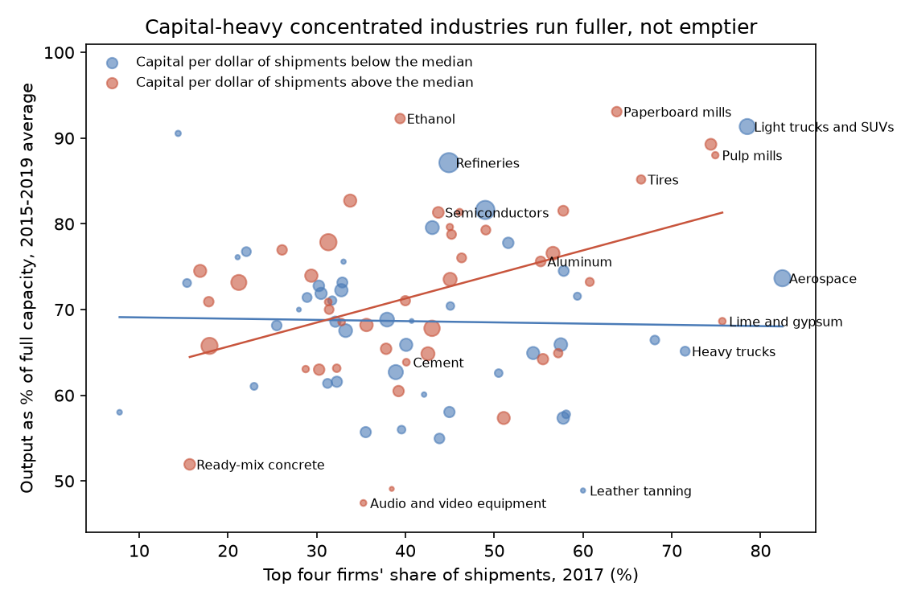
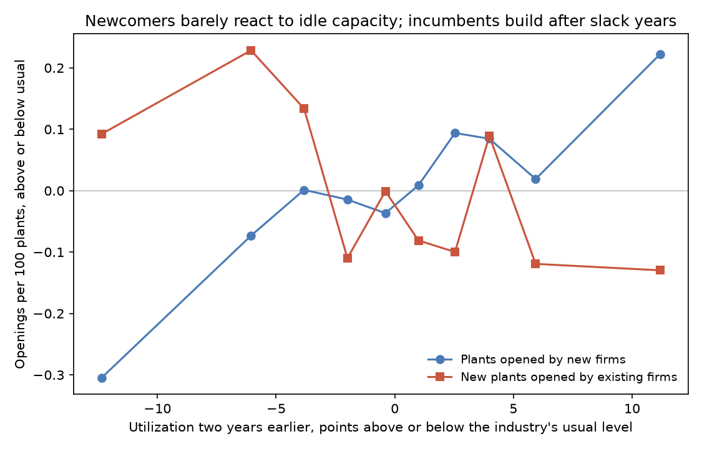

# The Empty Factory as a Warning

### In 1977 Michael Spence argued that a company could keep rivals out by building more factory than it needed, and in 1980 Avinash Dixit argued that it never would. I asked the Census Bureau's plant records which of them American manufacturing looks like today.

---

In 1945 Judge Learned Hand, deciding the government's antitrust case against the Aluminum Company of America,
wrote a passage about factories that economists still quote. Alcoa insisted that it had never excluded a
competitor. Hand answered that nothing had compelled it to keep doubling and redoubling its capacity for aluminum
ingot before others entered the field, and that he could think of no more effective exclusion than to "face every
newcomer with new capacity already geared into a great organization."

Aluminum is still a business of large, expensive plants. In 2009 the industry's American plants produced 62.6% of
what they could have produced at full production, and in 2022 they produced 86.6%. In 2017 the four largest firms
in each aluminum product line made, on average, 55.2% of its shipments. Between 2010 and 2023, brand-new firms
opened 187 aluminum plants and established firms opened 28. Whether the idle capacity of a year like 2009 was an
accident of the recession or a quiet warning to anyone thinking of building a smelter is the question this
repository is about.

---

## How full a factory runs

Every quarter the Census Bureau asks a sample of plants, roughly 7,500 of them by the Bureau's own description, for
the value of what they produced and their own estimate of what they could have produced at full production. The
ratio is **capacity utilization**, and the Bureau adds the plants' answers up by industry group,

```math
U_{it} = 100 \times \frac{\text{actual production}_{it}}{\text{full production capability}_{it}},
\qquad \text{idle capacity}_{it} = 100 - U_{it}
```

where $`i`$ is an industry and $`t`$ a year (the average of four quarters). For alumina and aluminum in 2009,

```math
U_{\text{aluminum},\,2009} = 62.6, \qquad \text{idle capacity} = 100 - 62.6 = 37.4
```

so more than a third of the industry's capacity stood unused that year. Over 2015 to 2019 the spread across
industries looked like this:

| Industry, 2015–2019 average | Output as % of full capacity | Idle |
|---|---|---|
| Paperboard mills | 93.1% | 6.9% |
| Alumina and aluminum | 75.6% | 24.4% |
| Audio and video equipment | 47.4% | 52.6% |

Two other measures carry the argument. The first is the **four-firm concentration ratio**, the share of an
industry's shipments made by its four largest companies, which the Census computes every five years as

```math
\text{CR4}_i = 100 \times \frac{\text{shipments of the four largest firms}_i}{\text{total shipments}_i}
```

In 2017 the four largest cement companies made 40.1% of the industry's $8.3 billion of shipments, so cement's
CR4 was 40.1. The second is the **entry rate**, the number of plants opened in a year by firms that did not exist
the year before, per 100 plants in the industry, from the Census Business Dynamics Statistics,

```math
E^{\text{new}}_{mt} = 100 \times \frac{B^{\text{new}}_{mt}}{\tfrac{1}{2}\left(P_{mt} + P_{m,t-1}\right)}
```

where $`B^{\text{new}}_{mt}`$ counts plants opened by new firms in industry $`m`$ during the twelve months to March
of year $`t`$ and $`P_{mt}`$ is the number of plants. Beverage makers had 5,583 plants in 2014 and 6,444 in 2015,
and new firms opened 1,035 of them in the 2015 year, so

```math
E^{\text{new}}_{\text{beverages},\,2015} = 100 \times \frac{1{,}035}{\tfrac{1}{2}(6{,}444 + 5{,}583)} = 17.2
```

I measure plants opened by firms already in business the same way, and call them incumbents' new plants.

---

## Michael Spence, Avinash Dixit, and the credible threat

Michael Spence grew up in Canada, studied philosophy at Princeton and mathematics at Oxford, and wrote his Harvard
doctoral thesis on market signaling under Kenneth Arrow and Thomas Schelling. In his Nobel autobiography he
remembered Schelling's curiosity ranging from tipping points and focal points to deterrence. He was teaching at
Harvard when the *Bell Journal of Economics* published "Entry, Capacity, Investment and Oligopolistic Pricing" in
1977, and in 2001 he shared the Nobel Memorial Prize with George Akerlof and Joseph Stiglitz for their analyses of
markets with asymmetric information.

The 1977 paper put Judge Hand's intuition into a model. An industry's established firms deter entry, Spence
argued, when they have enough capacity to make a newcomer's plant unprofitable. That capacity need not be in use
before entry. It is a threat that output will rise and prices fall the moment a rival builds, and it works because
capacity is a sunk, irreversible commitment that the incumbent cannot take back. The paper concluded that the
result is higher costs than the output requires and higher prices than the older limit-price models implied.

Avinash Dixit, who studied in Bombay and Cambridge and took his doctorate at MIT, answered in the
*Economic Journal* in 1980 with "The Role of Investment in Entry-Deterrence." His point was about credibility. A
newcomer should believe only threats the incumbent would want to carry out after it has entered, and capacity the
incumbent would not want to use after entry is no threat at all. A textbook version of his model makes the argument
in a few lines. Take market demand $`P = a - x_1 - x_2`$, where $`x_1`$ is the incumbent's output and $`x_2`$ the entrant's. The incumbent buys
capacity $`k`$ at $`r`$ per unit before the entrant decides; output up to $`k`$ then costs $`w`$ per unit, and
output beyond it costs $`w + r`$. The entrant pays a fixed cost $`F`$ and $`w + r`$ per unit, and after entry the
two choose outputs at the same time. Then

```math
\begin{aligned}
\pi_2(x_1) &= \tfrac{1}{4}\,(a - w - r - x_1)^2 - F \\
\pi_2 \le 0 \;&\iff\; x_1 \ge \bar{x} \equiv a - w - r - 2\sqrt{F} \\
x_1^{\text{post}} &\le N \equiv \tfrac{1}{3}(a - w + r) \le \tfrac{1}{2}(a - w) \\
k^{*} = \bar{x} \le N \;&\Rightarrow\; x_1^{\text{pre}} = \min\{k^{*},\ \tfrac{1}{2}(a - w)\} = k^{*}
\end{aligned}
```

The first line is the entrant's best profit when the incumbent produces $`x_1`$, the second the output that wipes
that profit out, and the third says the incumbent will never produce more after entry than $`N`$, the output at
which its cost-$`w`$ reaction meets the entrant's (the last inequality holds whenever $`2r \le a - w`$, that is,
whenever capacity is cheap relative to the size of the market). When deterring is feasible and pays, the incumbent
installs exactly the deterring capacity $`k^{*}`$, and because
that is below what it would produce as an unthreatened monopolist with marginal cost $`w`$, it runs every unit
before entry as well as after. Deterrence can still work, but it works through capacity that is used, and idle
capacity is never part of it.

The strongest objection to Dixit came in 1985 from Jeremy Bulow, John Geanakoplos and Paul Klemperer, who showed in
the same journal that with other demand curves an incumbent can rationally hold idle capacity and use it after
entry. The strongest objection to Spence came from the data. In 1987 Marvin Lieberman, then at Stanford, followed
38 chemical products over roughly twenty years each, plant by plant. Incumbents and entrants built new plants at
similar levels of market growth and utilization, and only three products (aniline, sorbitol and Dow Chemical's
magnesium) showed signs of capacity held to deter entry. Even in those three, some entry occurred. He concluded that
such barriers are rare in practice and seldom fully effective.

The question still matters because the threat Spence described is the conduct that cases like Alcoa's tried to
police, and capacity built ahead of demand is still how heavy industries grow. If idle capacity keeps rivals
out, it should show up where the theory says it pays most and it should go with fewer newcomers.

---

## How I tested it

The theory makes two predictions that public data can check. If incumbents hold capacity as a threat, industries
where deterrence pays most should run with more idle capacity. Those are concentrated industries, where there are
profits worth protecting, and capital-heavy ones, where capacity is sunk and the threat is believable. And more idle
capacity should go with fewer new firms building plants. Dixit's model predicts no strategic idle capacity, so
utilization should not fall with concentration in capital-heavy industries. Any idle capacity there should reflect
demand swings and lumpy plants, the explanations Lieberman found in chemicals.

For the first test I took the Census Quarterly Survey of Plant Capacity Utilization for 2008 to 2024, joined
industry groups whose definitions changed so that each industry means the same thing every year (89 industries
have complete data for 2015 to 2019), and matched them to the 2017 Economic Census. The Census reports concentration
for 6-digit industries, so an industry's CR4 is the shipment-weighted average of its 6-digit CR4s. Capital intensity is
gross depreciable assets per dollar of shipments, and an industry is capital-heavy if it is above the median of 60
cents. I control for plant size (shipments per plant, in logs, Lieberman's lumpiness) and demand volatility (the
standard deviation of annual employment growth, 1990 to 2019). The estimating equation, with robust (HC1) standard
errors, is

```math
\begin{aligned}
U_i &= \alpha + \beta\,\text{CR4}_i + \eta H_i + \delta\,(\text{CR4}_i \times H_i) \\
&\quad + \theta_1 \ln S_i + \theta_2 V_i + \varepsilon_i
\end{aligned}
```

where $`U_i`$ is the industry's 2015–2019 average utilization, $`H_i`$ marks capital-heavy industries, $`S_i`$ is
shipments per plant and $`V_i`$ is demand volatility. Spence predicts $`\beta + \delta < 0`$, idle capacity rising
with concentration where capacity is sunk. Dixit predicts $`\beta + \delta = 0`$.

For the second test I joined those industries into 69 markets that line up with the 4-digit codes of the Business
Dynamics Statistics and followed them from 2010 to 2023. Lieberman allowed two years between the decision to
build a chemical plant and its opening, so I compare openings with utilization two years earlier, and I control for
employment growth over the two years before that. Each market is compared with itself, net of the national swing in
every year,

```math
E^{\text{new}}_{mt} = \beta\,U_{m,t-2} + \gamma\,g_{m,t-2} + \mu_m + \lambda_t + \varepsilon_{mt},
\qquad H_0:\ \beta = 0
```

where $`g_{m,t-2}`$ is the market's annual employment growth over $`t-4`$ to $`t-2`$, $`\mu_m`$ and $`\lambda_t`$
are market and year effects, and standard errors are clustered by market. A positive $`\beta`$ means newcomers stay
away when capacity sits idle, which is what Spence's threat requires.

---

## Concentrated, capital-heavy industries run fuller, not emptier

Among capital-heavy industries, the more concentrated the industry, the harder its plants run. Among light
industries the slope goes the other way. Pooled together, with plant size and demand swings held fixed, the two
cancel, and the overall slope is close to zero (−0.060, standard error 0.077).

| Top four firms' share | Light industries | Utilization | Capital-heavy industries | Utilization |
|---|---|---|---|---|
| Under 30% | 9 | 71.7% | 8 | 68.8% |
| 30–50% | 23 | 68.1% | 24 | 70.7% |
| 50% or more | 13 | 67.5% | 12 | 76.5% |

The cell where Spence's theory says idle capacity should pile up, concentrated and capital-heavy, has the fullest
plants of the six. With the controls, the slope of utilization on concentration for capital-heavy
industries in 2015 to 2019 is

```math
\begin{aligned}
\hat{\beta} + \hat{\delta} &= 0.113\ (0.081),\quad 95\%\ \text{CI}\ [-0.046,\ 0.272],\quad N = 89 \\
\hat{\beta} &= -0.270\ (0.107), \qquad \hat{\delta} = 0.383\ (0.121),\ p = 0.002
\end{aligned}
```

and in 2021 to 2024 it is 0.202 (0.078), with p = 0.010. The 2015 to 2019 slope is not statistically different from
zero. In the point estimates, a capital-heavy industry where the top four make 20 more points of shipments runs
about 2 to 4 points closer to full capacity, the opposite of Spence's sign. All twelve industries in the concentrated,
capital-heavy cell are listed below.

| Industry | Top four's share | Capital per $ of shipments | Output as % of capacity, 2015–19 |
|---|---|---|---|
| Paperboard mills | 64% | $1.65 | 93.1% |
| Petrochemicals | 74% | $0.70 | 89.3% |
| Pulp mills | 75% | $2.46 | 88.0% |
| Tires | 67% | $1.00 | 85.2% |
| Paper mills | 58% | $1.62 | 81.5% |
| Beverages | 57% | $0.74 | 76.6% |
| Alumina and aluminum | 55% | $0.68 | 75.6% |
| Fertilizer | 61% | $1.81 | 73.2% |
| Lime and gypsum | 76% | $1.38 | 68.6% |
| Computers and peripherals | 57% | $0.61 | 64.9% |
| Engines and turbines | 55% | $0.62 | 64.2% |
| Farm, construction and mining machinery | 51% | $0.60 | 57.4% |

The bottom three sit just above the 60-cent line and sell machinery to cyclical buyers.



In light industries concentration goes with more idle capacity, about 2.7 points for every 10 points of CR4. This is
the one place in the data where concentration and slack travel together, and I cannot rule out a strategic reading
of it. But these are the industries where capacity is cheapest to add and therefore the weakest commitment, the
opposite of the conditions Spence's argument needs. The concentrated light industries with the most slack sell to
cyclical buyers, among them rail cars, ships and boats at 57.4%, farm chemicals at 57.8%, heavy trucks at 65.1% and household appliances at 66.4%, and their
idle capacity looks like the kind that follows orders. Capital-heavy plants such as paper machines,
crackers and tire lines are expensive to leave standing, and their owners run them hard, which fits Dixit's
prediction and Lieberman's account better than Spence's.

---

## Idle capacity does not keep newcomers out

The second prediction fails as well. Within a market, years that followed slack capacity brought about as many new
firms as years that followed tight capacity, with

```math
\hat{\beta} = 0.014\ (0.013),\quad 95\%\ \text{CI}\ [-0.011,\ 0.040],\quad N = 944,\ 69\ \text{markets}
```

New firms open 4.39 plants per 100 existing plants in an average market-year. A 10-point fall in utilization,
smaller than the 2008-to-2009 drop in aluminum (22 points) or cement (18 points), goes with 0.14 fewer new plants
per 100, about 3% of the usual rate, and the confidence interval runs from 0.40 fewer to 0.11 more. The coefficient does not grow in concentrated
markets (the difference is −0.007, with a standard error of 0.017) or in capital-heavy ones, it stays near zero
using a one-year lag, the pre-pandemic years alone, or jobs at new plants rather than plant counts, and over
1982 to 2023, using the Federal Reserve's utilization rates for 22 broad industries, it is slightly negative and
not significant.

Differences in entry across markets are large, and they line up with the kind of industry rather than its slack.

| Market | Average utilization, 2008–21 | Top four's share | New firms' plants per 100, 2010–23 |
|---|---|---|---|
| Rail cars, ships, boats | 52.8% | 58% | 5.8 |
| Cement and concrete | 56.1% | 19% | 1.5 |
| Tobacco | 57.7% | 91% | 10.5 |
| Basic chemicals and ethanol | 80.6% | 46% | 2.1 |
| Refineries and asphalt | 83.6% | 45% | 1.7 |
| Pulp, paper and paperboard | 87.3% | 62% | 1.9 |

Tobacco plants ran at 57.7% of capacity and still drew new firms at more than twice the average market's rate,
while paper mills, which ran nearly full, drew very few. New firms build small plants in industries where small
plants can survive, and they rarely build pulp mills or refineries whatever the utilization rate.

---

## Incumbents build after slack years, everywhere

Lieberman's test of pre-emption compared who builds. If incumbents add capacity to head off entrants, they should
build before capacity runs short, so their openings should depend less on utilization than newcomers' do, and the
gap should be widest in concentrated industries. I estimated both kinds of openings as Poisson rates, with each
market's plant count as the exposure,

```math
\mathbb{E}\left[B^{b}_{mt}\right] = \exp\!\left(\beta_b U_{m,t-2} + \gamma_b g_{m,t-2} + \mu_{mb} + \lambda_{tb} + \ln \bar{P}_{mt}\right)
```

where $`b`$ is either new firms or incumbents, $`\bar{P}_{mt}`$ the average plant count, and the null is
$`\beta_{\text{inc}} = \beta_{\text{new}}`$, Lieberman's finding. The result is

```math
\begin{aligned}
\hat{\beta}_{\text{new}} &= 0.0033\ (0.0024), \qquad \hat{\beta}_{\text{inc}} = -0.0102\ (0.0025) \\
\hat{\beta}_{\text{inc}} - \hat{\beta}_{\text{new}} &= -0.0135\ (0.0040), \quad p < 0.001,\quad N = 944
\end{aligned}
```

For every point utilization was below its usual level two years earlier, incumbents opened about 1% more new plants,
and 1.6% more jobs at them, while newcomers' openings did not move. That is the one pattern in these data that looks like Spence's pre-emption, and it does not sit where his theory puts it.
In concentrated markets the incumbents' gap is, if anything, smaller (the extra term is +0.0079, standard error 0.0063),
and since newcomers do not respond to slack, the extra plants keep no one out. Over 1982 to 2023 in the broad Federal
Reserve industries the gap disappears (+0.0046, standard error 0.0071).



Incumbents' plants are not the same kind of plant as newcomers'. Across all 69 markets they opened 32% of new plants
but 56% of the jobs at new plants, with 21.0 jobs per plant against 7.8 for a newcomer's.

| Market | Top four's share | Incumbents' share of new plants | Incumbents' share of new-plant jobs | Jobs per new plant, incumbent / newcomer |
|---|---|---|---|---|
| Cars, light trucks, heavy trucks | 71% | 15% | 49% | 91 / 17 |
| Pulp, paper and paperboard | 62% | 23% | 46% | 92 / 32 |
| Household appliances | 68% | 8% | 45% | 85 / 9 |
| Engines and turbines | 55% | 34% | 74% | 91 / 17 |
| Aerospace | 82% | 43% | 71% | 60 / 18 |
| Alumina and aluminum | 55% | 13% | 27% | 70 / 29 |
| Cement and concrete | 19% | 72% | 77% | 14 / 10 |

Established firms opened 52 vehicle plants over the period to newcomers' 288, but those 52 carried half the jobs.
The pattern looks like established firms replacing and relocating big plants when demand has been soft, rather
than firms racing to fill the market before a rival can. Lieberman's own model has a term for this replacement
building, which depends on how many plants an industry already has rather than on how fast its market grows.

---

## Why it matters

For consumers, the worry behind Spence's model is that an industry pays for capacity it never uses and passes the cost
on in prices. In the industries where that would be most expensive, the concentrated and capital-heavy ones, plants
run fuller than elsewhere, so the bill for deliberately idle plants does not appear in these data.

For workers, the slack that stands out sits in cyclical, mostly light industries such as ships, trucks and
appliances. For the people in those plants, idle capacity is a business-cycle problem, not a monopoly problem.

For smaller firms and would-be entrants, slack capacity is not the wall the theory imagined. Newcomers opened plants
at the same rate after slack years as after tight ones. What appears to stop them in paper, refining and chemicals
is the scale of the plant a new firm would need.

For antitrust, the Alcoa standard treats capacity built ahead of demand as a possible exclusionary act. These data
say that incumbents do build after slack years, but they do so in competitive and concentrated industries alike, and
their building does not coincide with fewer entrants. A case built on capacity has to show that the capacity changed
an entrant's decision, because the general pattern does not.

---

## Limits of this study

Utilization is reported by plants for whole industry groups and averaged over shipments, so a single dominant firm
holding idle capacity in a market of busy rivals could disappear in the average, and the theory is about firms, not
industries. The Census leaves the estimate of full production to each plant, and managers may read it differently.
Concentration is national and from a single year, 2017, which overstates competition in local businesses like
cement and ignores imports. The Business Dynamics Statistics count establishments, not capacity, so an incumbent's new
warehouse-sized plant and a startup's machine shop each count once, and a firm's first plant in a new industry counts
as an incumbent's opening if the firm already existed elsewhere. The panel has 69 markets, so the clustered standard
errors are only approximate, and with fourteen years it can detect large effects of slack on entry but not small ones.
Nothing here measures what entrants believed, which is what the theory is about, so the results show that idle
capacity does not behave like a deterrent on average, not that it never deterred anyone.

---

## Further reading

- [TECHNICAL.md](TECHNICAL.md) has the data, the rules, every test statistic and how to reproduce the results.
- [results/FINDINGS.md](results/FINDINGS.md) has a plain-English summary and every table the scripts produce.
- [METHODS_REVIEW.md](METHODS_REVIEW.md) is a methods and reporting review of the original papers.
- The original papers are A. Michael Spence, "Entry, Capacity, Investment and Oligopolistic Pricing," *Bell Journal
  of Economics* 8(2), Autumn 1977, pp. 534–544, and Avinash Dixit, "The Role of Investment in Entry-Deterrence,"
  *Economic Journal* 90(357), March 1980, pp. 95–106.
- Marvin B. Lieberman, "Excess Capacity as a Barrier to Entry: An Empirical Appraisal," *Journal of Industrial
  Economics* 35(4), June 1987, pp. 607–627, posted on the author's UCLA Anderson faculty page.
- Jeremy Bulow, John Geanakoplos and Paul Klemperer, "Holding Idle Capacity to Deter Entry," *Economic Journal* 95,
  March 1985, pp. 178–182.
- Capacity utilization comes from the US Census Bureau, Quarterly Survey of Plant Capacity Utilization, 2008–2024
  quarterly tables, at www2.census.gov/programs-surveys/qpc/tables/. Concentration, shipments, plants and assets come
  from the 2017 Economic Census (tables EC1700SIZECONCEN and EC1731BASIC). Plant openings come from the Census
  Business Dynamics Statistics, 2023 release, NAICS 4-digit by firm age (bds2023_vcn4_fa). The long-run utilization
  series are from the Federal Reserve Board's G.17 release (utl_sa.txt). The QPC sample size is from the survey's
  methodology page, www.census.gov/programs-surveys/qpc/technical-documentation/methodology.html.

*Brendyn Beasley*
